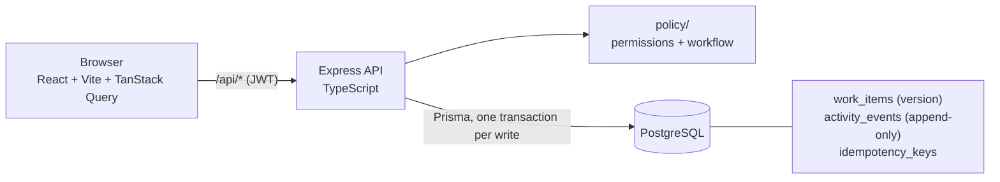

# Operations Under Pressure — internal work-item tracker

A small full-stack app for creating, assigning, tracking and resolving operational work items across teams
(Newtonite Software Engineering Challenge). Users belong to one or more teams with a **role per team**
(Viewer / Member / Lead / Admin). Items move through a **server-enforced workflow** with a Lead-only approval step,
every state / owner / priority change is recorded in an **append-only activity log written in the same transaction**,
and the dashboard shows "Assigned to me", "Unassigned urgent" and "Awaiting my approval" with search, filters and
**server-side cursor pagination**.

The brief rewards judgement over feature count, so the focus is correctness under concurrency, real server-side
authorization, idempotency, workflow rules and tests. See [ENGINEERING_DECISIONS.md](ENGINEERING_DECISIONS.md).



## Prerequisites

- Node.js 20+ and npm
- Docker (Docker Desktop on Windows/macOS) for PostgreSQL
- Internet access for `npm install` (Prisma also downloads its tooling on `prisma generate`)

## Setup and run (exact commands)

```bash
# 1. config (Windows cmd: copy .env.example .env)
cp .env.example .env

# 2. start PostgreSQL 16 in Docker (waits until healthy)
npm run db:up

# 3. install backend + frontend dependencies
npm run setup

# 4. create the schema (applies backend/db/migrations/*.sql; safe to re-run)
npm run db:migrate

# 5. load demo data: 4 teams, 10 users, 3000 items (+ history, comments). DESTRUCTIVE: wipes the tables first
npm run db:seed

# 6. run the API (terminal 1)  ->  http://localhost:4000/api/health
npm run dev:backend

# 7. run the UI (terminal 2)   ->  http://localhost:5173
npm run dev:frontend
```

### Database setup notes
- `docker compose` runs **only Postgres** (user/password/db = `ops`/`ops`/`ops`, port 5432). The API and UI run with npm.
- Migrations are plain SQL in `backend/db/migrations/`, applied in order by `npm run db:migrate` and tracked in a
  `schema_migrations` table. (Plain SQL because the schema needs trigram/partial indexes, CHECK constraints and a trigger
  that Prisma's schema language cannot express. Prisma is used as the typed query layer.)
- The migration runs `CREATE EXTENSION pg_trgm`, which the Docker image's `ops` superuser is allowed to do.
- Reset everything: `npm run db:down`, then `docker volume rm newtonite-ops_pgdata` (volume name = folder name + `_pgdata`), then repeat steps 2-5.
- If you want a different seed size: `SEED_ITEMS=20000 npm run db:seed`.

## Demo credentials

Password for **every** demo user: `Password123!`

| Email | Teams : role |
|---|---|
| asha.admin@ops.test | all four teams : **Admin** |
| priya.lead@ops.test | Payments Ops : **Lead**, Compliance : Member |
| rahul.lead@ops.test | Customer Support : **Lead** |
| neha.lead@ops.test | Compliance : **Lead** |
| vikram.lead@ops.test | Platform Incidents : **Lead** |
| aman.member@ops.test | Payments Ops : Member, Customer Support : Member |
| sana.member@ops.test | Customer Support : Member |
| rohan.member@ops.test | Compliance : Member, Platform Incidents : Member |
| isha.member@ops.test | Platform Incidents : Member |
| kabir.viewer@ops.test | Payments Ops : **Viewer**, Customer Support : **Viewer** |

Things worth trying in a demo: log in as `sana.member` and open a Payments item (404, she's not in that team); as `kabir.viewer`
(read-only, no buttons); claim an "Unassigned urgent" item in two browser windows (one gets 409); approve as a Member (403) vs a Lead.

## Tests

```bash
npm run db:up      # tests need Postgres running
npm test           # one command: runs the whole suite
```

The test run uses a **separate database `ops_test`** (created and migrated automatically; it refuses to run against a
database whose name does not end in `_test`), so it never touches your demo data. 65 tests across 9 files in `backend/tests/`:

| File | Proves |
|---|---|
| `concurrency.test.ts` | Parallel claims: exactly one winner (2 and 8 racers), others get 409 |
| `stale-update.test.ts` | Old `version` -> 409 + latest item, data not overwritten; the UPDATE statement itself is guarded (deterministic race injection) |
| `idempotency.test.ts` | Same key (even 5 in parallel) -> one item, same response; key reuse with a different body -> 422 |
| `workflow.test.ts` | Invalid jumps -> 422; only a Lead **of that team** can approve; full happy path and event trail |
| `authorization.test.ts` | Other-team user gets 404 on every read/write; viewer 403; lists never leak; role change is immediate |
| `atomicity.test.ts` | If the activity write fails, the item change rolls back; DB rejects UPDATE/DELETE on history |
| `pagination.test.ts` | Cursor pages: no duplicates/gaps (including identical timestamps); server-side filters and search |
| `auth.test.ts` | Login, no user enumeration, no hash leakage |
| `production.test.ts` | DB-checking health endpoint, SPA fallback for deep links, JSON 404s for `/api`, asset caching, CORS allow-list, security headers |

### Browser end-to-end tests (optional, real Chrome)

`e2e/` is a separate package (so `npm test` and `npm run setup` stay light). It drives the real UI in headless Chrome as
Member (`aman`), Lead (`priya`), another Member (`sana`) and Viewer (`kabir`) - login, session refresh, logout, all three dashboard
views, search, filters, pagination (UI row counts are compared with database counts), item create / claim / submit / edit / comment,
a stale-edit conflict between two browsers, Lead approve / reject / close, a two-browser concurrent claim, per-team roles, team
isolation, and error states. **31 checks.**

```bash
npm run build                                   # builds backend + frontend
NODE_ENV=production JWT_SECRET=<32+ random chars> SEED_DEMO_DATA=true npm start   # API + UI on http://localhost:4000
npm run e2e:install                             # once
E2E_BASE_URL=http://localhost:4000 npm run e2e  # uses DATABASE_URL / E2E_DATABASE_URL for the count cross-checks
```
It creates a few items/comments (titles start with `E2E `), so run it against a demo database. On Linux a bundled Chromium is used;
on macOS/Windows set `CHROME_PATH` to your Chrome executable.

## Deployment

The app is **one Node service plus PostgreSQL**: in production the Express server also serves the built React app (with SPA fallback,
so refreshing `/items/<id>` works) from the **same origin** as the API. That means no CORS, no API base-URL setting, and no localhost
URLs in the production bundle (the UI calls the relative path `/api`).

```bash
npm run build        # typechecks + compiles the backend (backend/dist) and builds the UI (frontend/dist)
npm start            # = migrate -> seed demo data ONLY if SEED_DEMO_DATA=true and the DB has no users -> start server
```

**Render (blueprint included: `render.yaml`):** push the repo to GitHub, then Render dashboard -> *New* -> *Blueprint* -> select the repo -> *Apply*.
It creates the database, wires `DATABASE_URL`, generates `JWT_SECRET`, builds, runs migrations, seeds demo data once, and uses `/api/health` as the health check.
Any host that can run Node 20 + Postgres works the same way (set the environment variables below).

| Variable | Required | Purpose |
|---|---|---|
| `DATABASE_URL` | yes | PostgreSQL connection string (on Render use the internal connection string) |
| `JWT_SECRET` | yes (prod) | Token signing key; the server **refuses to start in production** if it is shorter than 32 characters |
| `NODE_ENV=production` | yes (prod) | Enables production behaviour (serves the UI, strict config checks) |
| `PORT` | no | Listen port (hosts usually set it; default 4000) |
| `JWT_EXPIRES_IN` | no | Token lifetime (default `8h`) |
| `BCRYPT_ROUNDS` | no | Password hash cost (default 10) |
| `SEED_DEMO_DATA` | no | `true` = seed demo users/items on first boot if the database has no users. **Demo only: the demo password is public** |
| `SERVE_FRONTEND` | no | Defaults to `true` in production; set `false` for an API-only deployment |
| `CORS_ORIGIN` | no | Comma-separated allowed browser origins; only for a split UI/API deployment (otherwise nothing is allowed cross-origin) |
| `VITE_API_URL` | no | **Build-time**, UI only: API origin for a split deployment (default is same-origin `/api`) |

No secrets are committed: `.env` is git-ignored, only `.env.example` (placeholders) is tracked, and `JWT_SECRET` is generated by the host.
Auth is a bearer token in the `Authorization` header (no cookies), so there is no CSRF surface and CORS never needs credentials.

## API summary (all under `/api`, JWT bearer auth except login)

| Method + path | Purpose |
|---|---|
| `GET /health` | Liveness + database check (no auth) |
| `POST /auth/login`, `GET /auth/me` | Login; current user + team roles |
| `GET /items` | List: `view=assigned_to_me\|unassigned_urgent\|awaiting_my_approval`, `status`, `priority`, `type`, `teamId`, `assignee`, `q`, `limit`, `cursor` |
| `POST /items` | Create (**Idempotency-Key required**) |
| `GET /items/:id` | Detail + what the current user may do (`allowed`) |
| `PATCH /items/:id` | Edit; body must include `version` |
| `POST /items/:id/claim` | Atomic claim (Idempotency-Key optional) |
| `POST /items/:id/transition` | `{ to, version }` (Idempotency-Key optional) |
| `GET /items/:id/activity` | Append-only history |
| `GET/POST /items/:id/comments` | Comments (POST needs Idempotency-Key) |

Errors: 400 validation, 401 not logged in, 403 in the team but role not allowed, **404 not in the item's team** (existence not revealed),
409 claim/version conflict (body includes `latest`), 422 invalid transition / key reuse.

## Roles and workflow

Roles are per team. A Viewer reads. A Member creates, comments, claims, edits items they created or own, and moves their own items forward
(start, submit for approval). A Lead (and Admin, same powers in this scope) can do all of that on any item in their team and is the
only one who can **approve, reject or close**.

```
OPEN --claim/start--> IN_PROGRESS --submit--> AWAITING_APPROVAL --approve (Lead)--> RESOLVED --close (Lead)--> CLOSED
                           ^                         |
                           +------ reject (Lead) ---+
```
Everything else (e.g. OPEN -> CLOSED) is rejected with 422. The map lives in `backend/src/policy/workflow.ts`; the role rules in `backend/src/policy/permissions.ts`.

## Assumptions (I would confirm these with a product manager first)

- Priority levels: Low / Medium / High / Urgent. "Unassigned urgent" = Urgent, unassigned, not Resolved/Closed.
- "Assigned to me" excludes Resolved/Closed (it is a to-do view; use the filters to see finished work).
- Admin has the same powers as Lead (the brief defines no Admin-only action).
- A Lead may approve an item they created or own (the brief does not forbid self-approval).
- Claiming moves OPEN -> IN_PROGRESS in the same step. Only OPEN, unassigned items can be claimed.
- Editing is allowed in any status, including Closed.

## Known limitations

- **Not built (deliberately):** transactional outbox + worker, optimistic-UI reconciliation, email, attachments, SSO, websockets (the UI refetches on focus), mobile app.
- No reassign / unassign, no moving an item between teams, no delete. Assignee is changed only by claiming.
- Idempotency keys are never expired (no cleanup job). Only successful responses are stored, so a failed request can be retried.
- Auth: JWT in `localStorage` (XSS-exposed), no refresh/revocation, no login rate limiting or lockout. Roles are re-read from the database on every request, so role changes apply immediately, but a token stays valid until it expires (8h).
- Pagination is newest-first, forward-only, with no total count. Search is substring match (`ILIKE`, trigram-indexed), not ranked relevance.
- Activity and comments for one item are returned in one response (capped at 500), not paginated.
- ASSIGNED events store the assignee's *name at the time* (an audit snapshot), not a foreign key.
- Schema is defined twice: `db/migrations/*.sql` is authoritative, `prisma/schema.prisma` must be kept in sync by hand. No down-migrations.
- The history table is append-only for UPDATE/DELETE via a trigger; a database owner could still drop the trigger or TRUNCATE.
- Prisma's pg adapter emits a harmless `pg` deprecation warning during tests.
- The UI has no component/unit tests; it is covered by the optional real-browser E2E suite (`npm run e2e`), which is not part of `npm test`.
- `render.yaml` could not be exercised on Render itself from my environment; the identical production path (build, migrate, seed-if-empty, serve API + UI on one port, `/api/health`) was run and browser-tested locally.

## Next week I would...

1. Add the transactional outbox + worker (retries, max attempts, idempotent handler) for "notify new assignee".
2. Optimistic UI with rollback on 409/403, plus a Playwright test for it.
3. Idempotency-key TTL cleanup job, login rate limiting, httpOnly-cookie sessions.
4. Reassign by Leads, SLA/due-date reminders, and a keyset-friendly "sort by due date / priority".
5. At 10x scale: read replica for the list endpoints, partition `activity_events` by month, dedicated search engine if search relevance matters.

## Project layout

```
backend/
  db/migrations/0001_init.sql     schema, indexes, CHECKs, append-only trigger
  prisma/schema.prisma            typed model for the Prisma client
  src/cli/{migrate,seed}.ts       entry points for `db:migrate` / `db:seed` (also used by `npm start`)
  src/db/seed.ts                  demo data generator
  src/policy/                     permissions.ts (who may do what), workflow.ts (allowed transitions)
  src/modules/{auth,items,comments,activity,idempotency}/
  src/middleware/                 auth (JWT + load team roles), errorHandler
  tests/                          Jest + Supertest
frontend/src/{api,auth,pages,components}
e2e/run.mjs                     real-browser end-to-end checks (optional)
docker-compose.yml  render.yaml  .env.example  ENGINEERING_DECISIONS.md
```
